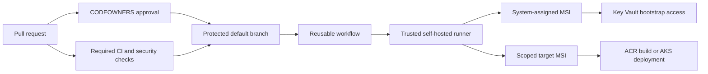
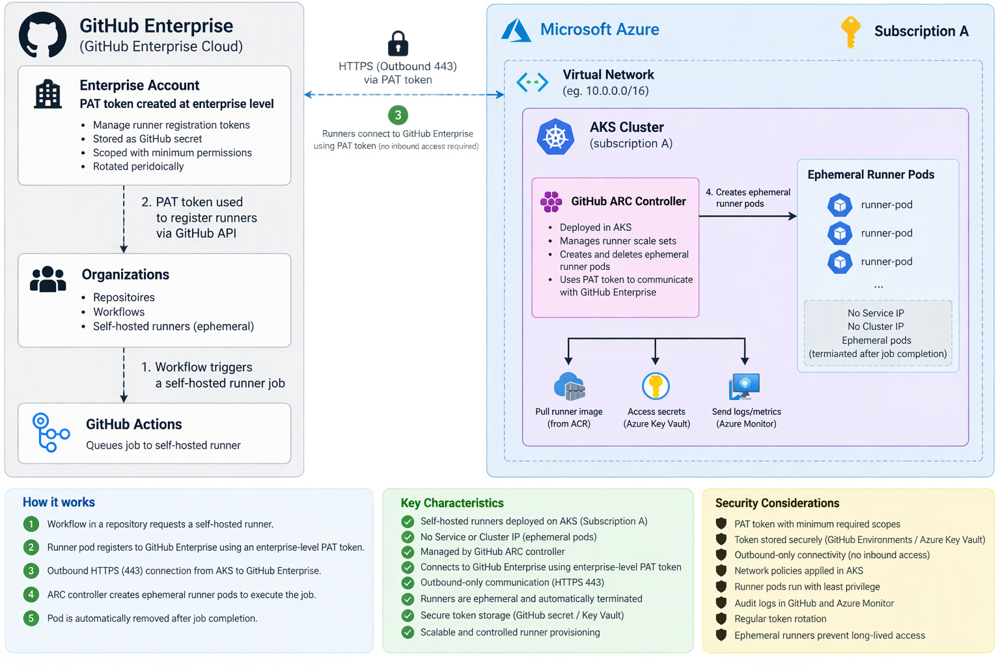
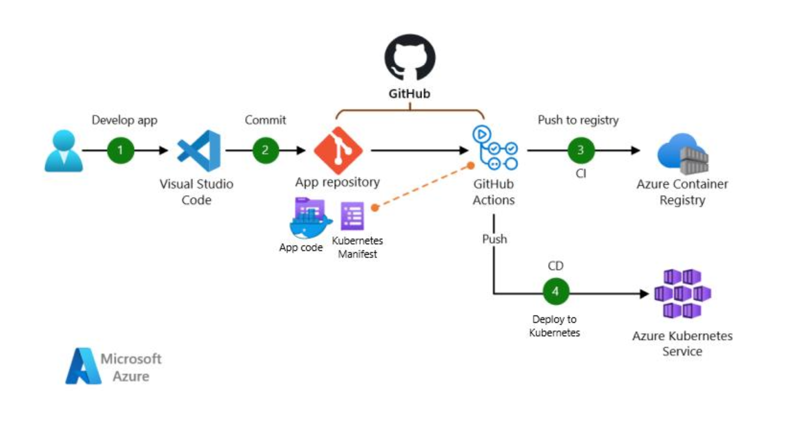
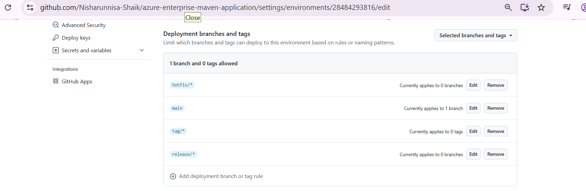
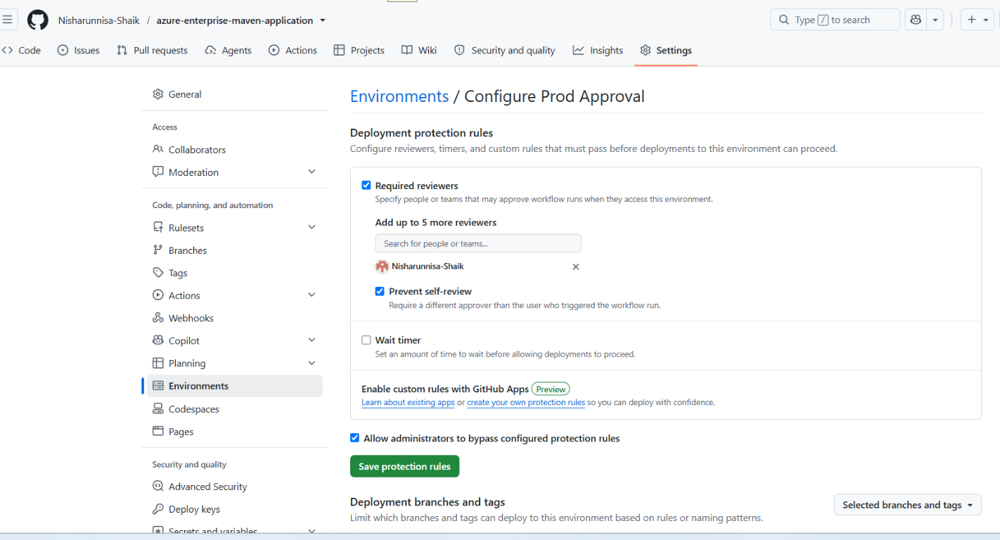
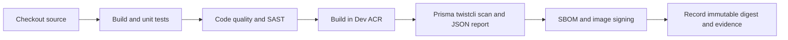
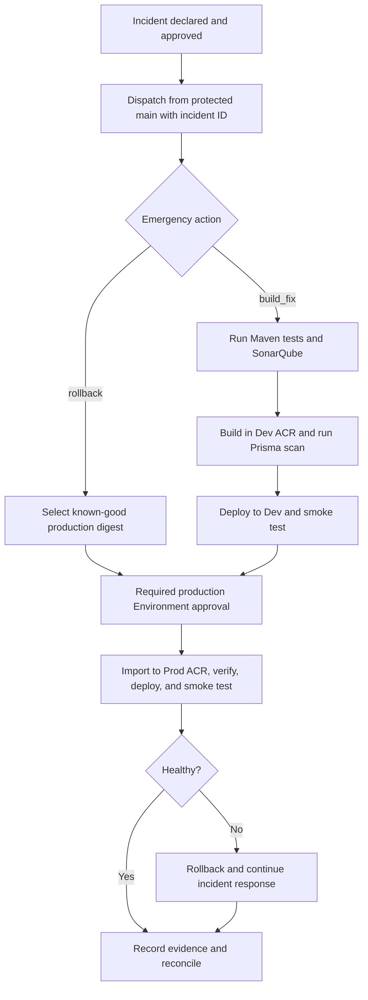

# Azure DevSecOps Platform Design Assessment

## Enterprise Paved-Road DevSecOps Platform

| Assessment detail | Value |
| --- | --- |
| **Selected cloud** | Microsoft Azure |
| **Candidate** | Nisharunnisa Shaik |
| **Role** | Senior DevOps Platform Engineer |
| **Version** | 1.0 |
| **Date** | November 2026 |

### Document control

| Platform area | Selection |
| --- | --- |
| Source control | GitHub Enterprise |
| CI/CD | GitHub Actions |
| Container platform | Azure Kubernetes Service (AKS) |
| Artifact repository | Azure Container Registry (ACR) |
| Secrets management | Azure Key Vault |
| Identity provider | Microsoft Entra ID |
| Self-hosted runners | GitHub Actions Runner Controller (ARC) on AKS |

> **Assessment status:** This document describes the proposed target platform. The repository currently contains a CI/CD scaffold; controls marked as proposed require implementation and GitHub/Azure configuration.

## Contents

1. [Executive summary](#1-executive-summary)
2. [Assumptions and exclusions](#2-assumptions-and-exclusions)
3. [Current-state challenges](#3-current-state-challenges)
4. [Platform architecture](#4-platform-architecture)
5. [Platform design](#5-platform-design)
6. [Controls as code](#6-controls-as-code)
7. [Artifact promotion strategy](#7-artifact-promotion-strategy)
8. [Progressive delivery runbook](#8-progressive-delivery-runbook)
9. [Emergency change workflow](#9-emergency-change-workflow)
10. [Metrics and reporting](#10-metrics-and-reporting)
11. [Migration and adoption plan](#11-migration-and-adoption-plan)
12. [Validation approach](#12-validation-approach)
13. [Risks and mitigations](#13-risks-and-mitigations)
14. [Known limitations](#14-known-limitations)
15. [Conclusion](#15-conclusion)
16. [References and AI disclosure](#16-references-and-ai-disclosure)

---

## 1. Executive summary

Forty engineering teams currently use inconsistent CI/CD implementations across multiple workloads. This creates fragmented audit evidence, broad production permissions, varying security standards, and inconsistent release and rollback practices.

The proposed Azure-based paved road provides:

- Centrally maintained reusable GitHub Actions workflows and composite actions.
- Ephemeral GitHub ARC runners for trusted build and deployment jobs.
- Azure Managed Service Identity (MSI) for pipeline access, without long-lived cloud credentials.
- Automated testing, security checks, artifact generation, and evidence capture.
- Build-once, promote-by-digest releases through development, UAT, and production.
- Progressive delivery, health-based promotion, and rollback.
- Central governance with documented extension points for application teams.

The platform standardizes mandatory controls while leaving application code, service-specific tests, and approved rollout thresholds with the owning teams.

## 2. Assumptions and exclusions

| Assumptions | Exclusions |
| --- | --- |
| GitHub Enterprise is the source control platform. | Azure landing-zone implementation. |
| AKS is the current container platform; Azure App Service is covered as a second compute type for eligible web workloads. | App Service deployment workflow implementation and application-level architecture design. |
| ACR stores trusted container artifacts. | Enterprise network architecture. |
| GitHub Advanced Security is available. | Disaster recovery beyond deployment rollback. |
| Azure Key Vault is the secrets platform. | Application-specific business logic and SLOs. |

## 3. Current-state challenges

| Area | Challenge | Platform response |
| --- | --- | --- |
| Delivery | Inconsistent pipelines | Reusable workflows and standard release contracts |
| Security | Broad production permissions | Managed identities and scoped Azure RBAC |
| Compliance | Fragmented evidence | Central checks and traceable release records |
| Operations | Different deployment standards | Shared deployment templates and environment gates |
| Governance | Teams can bypass controls | Protected branches, code owners, and required checks |
| Reliability | Limited rollback capability | Progressive delivery with health-based rollback |

## 4. Platform architecture

### 4.1 Repository governance

The repository governance model combines branch protection, code-owner review, required security checks, environment protection, and auditable deployment history. Azure jobs run on trusted self-hosted runners using managed identities; no OIDC federation is used.

**Figure 1. Repository governance and MSI-based Azure access**

### 4.2 Platform and project organizations

Platform Engineering owns reusable workflows, composite actions, deployment templates, runner configuration, and security policies. Project teams own application repositories, service configuration, and release schedules.

**Figure 2. Templates and project organization model**

### 4.3 Ephemeral runner architecture

GitHub ARC provisions short-lived runner pods in AKS. Runners are created for trusted jobs and removed when those jobs complete, reducing the exposure of persistent runner credentials and workspaces.

**Figure 3. GitHub ARC self-hosted runner architecture**

### 4.4 End-to-end delivery architecture

The platform connects source control, reusable GitHub Actions workflows, ACR, and AKS deployments. Environment configuration changes between stages; the application image digest does not.

**Figure 4. End-to-end Azure DevSecOps platform architecture**

### 4.5 Production Environment evidence

The following repository-setting screenshots are included with the architecture diagrams as evidence of the current production Environment configuration. They are point-in-time captures, not a claim that the settings have since been changed.

**Figure 5. Production Environment deployment branch/tag rules.** `main` currently matches one branch; `hotfix/*`, `release/*`, and `tag/*` currently match no branches or tags. The wildcard rules would allow matching future refs. Remove them if production deployment must be restricted to `main` only.

**Figure 6. Production Environment approval rules.** Required reviewers and prevent-self-review are enabled. Administrator bypass is also enabled in this capture, so the setting must be turned off and a new screenshot captured before claiming that production protections cannot be bypassed.

## 5. Platform design

### 5.1 Repository ownership model

| Repository location | Owner | Contents |
| --- | --- | --- |
| Platform/templates organization | Platform Engineering | Reusable workflows, composite actions, security policies, runner templates, samples, and documentation |
| Project organization | Application teams | Application source, Kustomize/Helm configuration, service tests, and environment-specific values |

#### Human access and decision rights

Assign GitHub organization teams to repositories using the minimum access needed. Keep repository administration separate from routine code review and deployment approval.

| Persona | Minimum GitHub access | Responsibilities | Guardrails |
| --- | --- | --- | --- |
| Platform/DevOps team | `Maintain` on the platform/templates repository; `Write` on application repositories | Own reusable workflows and actions, runner templates, platform standards, and workflow onboarding; review owned files through `CODEOWNERS` | Do not use shared administrator access for day-to-day changes; protected branches and required checks still apply |
| Developer | `Write` on the application repository | Commit and push feature branches, open pull requests, and respond to review feedback | No direct updates to protected branches; merging requires the configured reviews and checks |
| Lead developer | `Write` on the application repository; listed as a `CODEOWNERS` reviewer for owned application paths | Review and approve pull requests for the application; confirm required checks before merge | Approval does not grant repository administration or production-environment bypass |
| Reader | `Read` on the repository | View and clone code and inspect pull requests | Cannot push commits or merge changes |
| Production approver | `Read` on the application repository and configured as a required reviewer for `prod` | Approve or reject a production deployment in the GitHub Environment | Approval-only: no code-write or merge permission; keep the approver separate from repository administrators/organization owners, prevent self-review, and disable administrator bypass |
| Repository administrator | `Admin`, limited to a small named owner group | Configure repository access, branch rulesets, Actions policy, and Environment protection | Not a routine developer or approver role; audit administrative changes and keep production bypass disabled |

GitHub Environment required reviewers can have `Read` access; only one configured reviewer needs to approve a deployment. This allows a production approver to approve the deployment without receiving code-write permission. Keep the approver separate from repository administrators and organization owners, whose broader access can undermine the intended separation of duties.

### 5.2 Standard CI build pipeline

Secret scanning/push protection and Dependabot alerts are enabled in each source application repository through GitHub Advanced Security/repository security settings; they are not stages in this CI workflow. A Dependency Review action may be configured as a separate required pull-request check. The Prisma `twistcli` action scans the image in the development ACR and uploads its JSON result as a workflow artifact. CI-required checks fail closed: an image is not promoted if a mandatory test, code-quality, or image-security gate fails. Approved exceptions must have an owner, justification, compensating control, and expiry.

### 5.3 Standard CD promotion and deployment pipeline

```mermaid
flowchart LR
    A[Deploy from Dev ACR to DEV AKS] --> B[Rollout and developer validation]
    B --> C[Import digest into UAT ACR using UAT MSI]
    C --> D[Deploy from UAT ACR to UAT AKS]
    D --> E[UAT validation]
    E --> F[Production approval]
    F --> G[Import digest into PROD ACR using PROD MSI]
    G --> H[Deploy from PROD ACR to PROD AKS]
    H --> I[Monitor and retain rollback version]
```

The CI build and scan produce one immutable development-ACR digest. Standard promotion is a release/CD stage after validation: the UAT MSI imports Dev to UAT, then the production approval gates the production MSI importing UAT to Prod. The emergency `build_fix` path instead smoke-tests the image in Dev, then the protected production job imports the same digest directly from Dev to Prod. Each import is by digest and must be verified before deployment. For same-tenant ACR imports, grant the destination environment MSI **Container Registry Data Importer and Data Reader** on both the source and destination registries; the production MSI therefore needs source access to both UAT (standard releases) and Dev (emergency fixes). Keep the build MSI limited to pushing to Dev. Each AKS kubelet identity separately receives pull access to its own ACR.

### 5.4 Reusable workflow contract

- Accept documented configuration through typed `workflow_call` inputs.
- Return stable outputs such as the immutable ACR image reference and deployment result.
- Keep mandatory security gates in the centrally maintained workflow.
- Pin reusable workflow and third-party action references to reviewed immutable revisions.
- Allow application teams to extend tests and configuration without disabling required controls.
- Deprecate breaking inputs through a published migration window.

## 6. Controls as code

Controls should run as pull-request and deployment gates. Repository settings, such as branch rulesets and Actions policies, should also be managed as code where practical and protected separately from the repository they govern.

For detailed repository implementation guidance, see [Repository Controls as Code](./REPOSITORY_CONTROLS_AS_CODE.md).

### 6.1 Repository controls

| Control | Enforcement | Evidence |
| --- | --- | --- |
| Protected branches | Require pull requests, code-owner approval, required checks, resolved conversations, and no force-push/deletion | Ruleset configuration and pull-request history |
| Workflow ownership | CODEOWNERS review for workflow, action, and policy changes | Code-owner review event |
| Least-privilege Actions token | Read-only `GITHUB_TOKEN` baseline; grant permissions only to the job that needs them | Workflow YAML and run permissions |
| Reusable workflow governance | Pin to reviewed revisions; use explicit inputs/secrets; prevent mandatory checks from being skipped | Workflow reference and run evidence |
| Environment protection | Require production approvers, prevent self-review, and restrict deployment branches | Deployment history and approval records |
| Repository security posture | Enable GHAS secret scanning/push protection and Dependabot alerts in each source application repository; these are not Maven CI jobs | Repository security settings and GHAS/Dependabot alerts |
| CI security gates | Require tests, SonarQube, container checks, and any separately configured code or dependency review jobs | Required status checks and scan reports |

Branch patterns should be agreed with teams; a baseline is `main`, `develop`, `release/*`, and `hotfix/*`. Only make checks mandatory after confirming they run reliably for all relevant pull requests.

#### GitHub Environment setup and production approvals

Create environments separately in each application repository under **Settings → Environments → New environment**. Create `dev`, `uat`, and `prod` before enabling deployment workflows; an environment used before protection is configured may not pause for approval.

- Store non-secret AKS, Key Vault, namespace, authentication mode, Key Vault secret names, ACR login server, workload names, Kustomize overlay, and smoke-test URL for each environment in the application repository's `configuration/maven-config.yaml`. The config action reads the selected environment; leave secret values in Key Vault.
- In `prod` → **Deployment protection rules**, add designated approval-only reviewers (they need only `Read` repository access) and enable **Prevent self-review**. At least one configured reviewer must approve the deployment. Disable **Allow administrators to bypass configured protection rules** when the policy requires no bypass. Restrict deployment branches/tags to the approved release refs; remove unused wildcard rules if production is intended to be `main`-only.
- The GitHub Environment is the approval boundary, not the source of AKS settings. Do not put Azure credentials in GitHub Environment secrets. The runner's system-assigned MSI bootstraps Key Vault access; target identity credentials remain in Key Vault.

The normal application workflow calls the reusable AKS workflow for `prod` after UAT validation. That reusable job declares the `prod` GitHub Environment, so GitHub pauses it for the configured approval. The emergency rollback path uses the same approval. For a newly built emergency fix, the workflow first runs CI, deploys the scanned digest to Dev, and smoke-tests it; the protected `prod` job then imports the same digest from Dev to the production ACR before deployment. This expedited path skips UAT; the normal release flow still requires UAT validation. Neither emergency path bypasses production reviewers. Current Environment screenshots are Figures 5 and 6 in Section 4.5.

### 6.2 Security controls

| Control | Gate and evidence | Current status |
| --- | --- | --- |
| Tests and code quality | Maven test reports and SonarQube quality-gate result in the workflow run | Included in the Maven CI template; verify with a successful run |
| Secrets | GHAS secret scanning and push protection in the source application repository; Key Vault and MSI for Azure access | Repository-level controls, not Maven CI jobs; verify repository security settings and Azure role assignments |
| Dependencies | Dependency graph, Dependabot alerts/security updates; optional Dependency Review PR check | Repository-level alerts are separate from CI; verify repository security settings and alert status |
| Container scanning | Prisma Cloud Compute `twistcli` report tied to the immutable image digest | Implemented as a workflow action; retain the JSON artifact from the run |
| SBOM generation | Generate SPDX or CycloneDX and associate it with the image digest | Proposed; no SBOM artifact is produced by the current workflow |
| Image signing | Sign and verify the image digest before promotion | Proposed; signing and verification are not implemented in the current workflow |
| Production approval | Protected GitHub `prod` Environment with required reviewers and prevent-self-review | Workflow declares the environment; verify the repository Environment settings and deployment approval record |

Infrastructure-as-code policy scanning is intentionally excluded from the current scope because no scanner is available. The Azure Policy guidance elsewhere in this assessment describes Azure resource/cluster governance; it is not evidence of an IaC scanning gate.

### 6.3 Identity and access

- Use MSI from trusted self-hosted runners; do not request GitHub OIDC tokens or store Azure credentials in repository secrets.
- Use the runner's system-assigned identity only for the required bootstrap access, such as reading target identity configuration from Key Vault.
- Use separate user-assigned MSIs for image publishing, non-production deployment, and production deployment where practical. Attach only the identities needed by the runner pool.
- Grant Azure roles at the narrowest applicable scope. The build MSI should push only to the required ACR; a deployment MSI should access only its target AKS resources and namespace.
- Keep ACR pull permissions on the AKS kubelet identity separate from deployment permissions.
- Store application secrets in Key Vault and retrieve only what a job needs.
- Use time-bound privileged access through Microsoft Entra PIM for approved emergency work.
- For ARC runners on AKS, validate how the runner job securely obtains MSI access; do not assume every pod should be able to access the node's managed identity endpoint.

No long-lived cloud credentials should be committed to repositories or printed in workflow logs.

## 7. Artifact promotion strategy

Build and scan an image once in the development ACR from the approved commit. Deploy it to development AKS and wait for developer validation. Then import the same image digest into the UAT ACR and deploy it to UAT AKS. After UAT validation and production approval, import that digest into the production ACR and deploy it to production AKS. Never rebuild the application image between stages. Verify each destination digest matches the source digest and record the import and deployment evidence.

```mermaid
flowchart LR
    A[Commit SHA] --> B[CI checks]
    B --> C[Build and scan once]
    C --> D[Dev ACR image at sha256 digest]
    D --> E[Deploy to DEV AKS]
    E --> F[Developer validation]
    F --> G[Import same digest to UAT ACR]
    G --> H[Deploy to UAT AKS]
    H --> I[UAT validation]
    I --> J[Production approval]
    J --> K[Import same digest to PROD ACR]
    K --> L[Deploy to PROD AKS]
```

Use separate managed identities and least-privilege ACR permissions for each import/deploy boundary. Capture the source and destination registry names, commit SHA, image digest, Prisma JSON report, SBOM/signature references, workflow run, approvals, and deployment outcome for every promotion.

The application caller now promotes the built digest from Dev to UAT after Dev validation, then from UAT to Prod after UAT validation and production approval. The reusable AKS deployment workflow calls the ACR import action and verifies the destination digest before deployment. Remaining operational prerequisites are populated ACR configuration, environment-specific MSI values, role assignments, and a successful end-to-end run.

The emergency `build_fix` mode follows a separate expedited path: CI builds and scans from the selected `main` commit, the digest is deployed and smoke-tested in Dev, then production approval gates the production MSI importing that digest from Dev to Prod. This emergency path skips UAT; grant the production MSI the required import/read role on Dev as well as Prod. The normal release workflow continues to use UAT as the production import source.

## 8. Progressive delivery runbook

The strategies below cover both compute types in the Azure target design: an AKS canary and an App Service blue-green slot swap. The current reusable deployment workflow implements a normal AKS rollout and rollback only; it does not yet configure weighted canary routing or deploy App Service slots.

### 8.1 AKS canary strategy

Run the stable and candidate versions as separate Kubernetes Deployments/Services. Use the [Azure-supported Istio add-on for AKS](https://learn.microsoft.com/en-us/azure/aks/istio-about) (or another approved weighted-routing gateway) to shift requests to the candidate. Start at 5%, then advance to 25%, 50%, and 100% only after the observation window and gates pass. Require at least 200 candidate requests per stage; if traffic is lower, extend the window to 30 minutes rather than treating missing data as a pass.

| Stage | Candidate traffic | Minimum observation |
| --- | ---: | --- |
| Initial | 5% | 10 minutes |
| Expand | 25% | 10 minutes |
| Expand | 50% | 15 minutes |
| Complete | 100% | 30 minutes of continued monitoring |

Use [Application Insights](https://learn.microsoft.com/en-us/azure/azure-monitor/app/app-insights-overview) for request/error/latency signals and [Azure Monitor managed Prometheus and Container Insights](https://learn.microsoft.com/en-us/azure/azure-monitor/containers/kubernetes-monitoring-enable) for pod and cluster signals. Suggested initial hard gates are:

| Signal | Fail condition |
| --- | --- |
| HTTP 5xx rate | At least 2% over a 5-minute window, with 200 or more candidate requests, in two consecutive windows |
| Availability | Below 99.5% over a 10-minute window |
| p95 request duration | Above the service SLO, or more than 20% above the stable version, in two consecutive 5-minute windows |
| Candidate pod health | Any candidate pod remains unready for 5 minutes, enters `CrashLoopBackOff`, or restarts more than twice in 10 minutes |
| Resource saturation | Candidate CPU or memory remains above 85% of its configured limit for 10 minutes |

On a hard-gate breach, immediately set candidate traffic to 0% and stable traffic to 100%; stop further promotion and retain the candidate pods, logs, metrics, and digest for investigation. If the stable version has already been replaced, redeploy the last-known-good immutable digest and verify readiness before resuming traffic. The current `kubectl rollout undo` behavior is not a substitute for weighted-route rollback; route configuration and rollback automation must be added before claiming canary automation is operational. Azure's Istio add-on supports traffic management and canary scenarios; Azure Monitor provides the required AKS telemetry.

### 8.2 Azure App Service blue-green strategy

For eligible App Service plans (Standard, Premium, or Isolated), deploy the candidate to a `staging` deployment slot while production continues serving the stable version. Keep slot-specific settings and connection strings marked as deployment-slot settings. Warm the staging slot, run smoke/health checks, and observe its metrics before swapping staging into production. If a staged traffic ramp is needed, use [App Service slot traffic routing](https://learn.microsoft.com/en-us/azure/app-service/deploy-staging-slots) (for example 5%, 25%, and 50%) and apply the same request gates as the AKS canary. Otherwise keep staging at 0% and use a blue-green swap.

Use Application Insights and Azure Monitor App Service metrics, plus the [App Service Health check endpoint](https://learn.microsoft.com/en-us/azure/app-service/monitor-instances-health-check). Apply the HTTP 5xx, availability, and p95 gates above; additionally stop the swap if the staging health check is unhealthy for 5 minutes or CPU/memory is above 85% for 10 minutes. After a successful swap, monitor production for 30 minutes. On failure, swap back to the last-known-good slot and confirm health before closing the incident. App Service slots provide a pre-production validation point and retain the previous production app after a swap, enabling this rollback path.

### 8.3 Promotion and rollback gates

For either compute type, stop promotion when a hard threshold is breached. Preserve the release commit, source/destination image digests, slot or route weights, approval records, Azure Monitor metric snapshots, application logs, and rollback result. Treat insufficient request volume, missing telemetry, or an unhealthy monitoring dependency as **no-go**, not as a passing gate. Tune the example thresholds against each service SLO before production use.

### 8.4 Database-change handling (future only)

The current application architecture has no database, so no migration job, database credential, or database approval is part of today's pipeline. If a future service adds Azure SQL or another datastore, use an expand-and-contract release:

1. Make additive, backward-compatible schema changes first; version the migration, make it idempotent, and run it as a separate least-privilege job before deploying code that depends on it.
2. Deploy code that can work with both old and new schema, backfill in bounded/restartable batches, and verify row counts and application invariants before switching reads/writes.
3. Remove old schema only in a later approved release after all old application instances are gone and the rollback window has expired. Do not automatically run a destructive down-migration when application rollback occurs.
4. For Azure SQL, confirm the configured backup retention and test [point-in-time restore](https://learn.microsoft.com/en-us/azure/azure-sql/database/recovery-using-backups) to a separate database before relying on recovery. For a failed irreversible migration or data corruption, stop rollout, preserve evidence, restore to a new database at the chosen point in time, validate it, and perform a controlled connection cutover; do not overwrite the source database as an automatic rollback.

This is a future policy only, not a claim that the current Maven application uses a database. Azure SQL automated backups and point-in-time restore are the provider-native recovery mechanism referenced for that future case.

## 9. Emergency change workflow

Emergency changes are for active incidents or material security risks, not schedule pressure.

In the application repository, `.github/workflows/emergency-deploy.yml` is manually dispatched from `main` with an incident/change ID and one of two actions:

- **`rollback`:** provide a known-good immutable image digest already present in the production ACR. The reusable AKS deployment workflow verifies the registry and digest, waits for the `prod` Environment approval, deploys it, and runs the production smoke test. A failed smoke test triggers a rollback attempt.
- **`build_fix`:** leave the image input empty. The workflow calls the reusable Maven CI workflow against the selected `main` commit. CI runs Maven tests and SonarQube, builds the image into the Dev ACR, scans it with Prisma `twistcli`, and retains the JSON report. After all gates pass, it deploys the immutable digest to Dev and runs the configured Dev smoke test. The protected `prod` Environment then pauses for reviewer approval; after approval, the production MSI imports the same digest from Dev into Prod, verifies it, deploys it, and runs the production smoke test. A failed test or scan blocks promotion. This emergency path skips UAT; the standard release flow continues to require UAT validation.

This design supports both recovery from a bad release and remediation of a new defect or Sev1 vulnerability without rebuilding an unscanned image or skipping the production approval. The new fix must be merged to protected `main` before dispatch. The workflow does not include an emergency gate-bypass input.

### Required controls

- Record the incident/change ID, severity, service, impact, incident commander, and approvers.
- Dispatch the workflow from protected `main`. For `rollback`, provide the known-good production digest; for `build_fix`, leave the digest input empty so CI builds and scans the fix from the selected commit. Retain the run URL and source commit as incident evidence.
- Activate least-privilege Microsoft Entra PIM access with MFA and justification; maximum activation duration is **4 hours**.
- Retain the available pipeline gates: Maven tests, SonarQube, Prisma image scan, Dev smoke test for a new build, production approval, and production smoke test. No emergency gate bypass is implemented. Keep application-repository GHAS secret scanning/push protection and Dependabot alerts enabled as independent repository controls, not as CI stages; SBOM generation and image signing remain proposed, not implemented.
- Deploy one immutable digest to the smallest affected scope; monitor health and retain a rollback option.
- Capture commit, digest, approvals, PIM activation, pipeline run, test/scan results, and before/after monitoring signals.
- Complete a post-incident review within **48 hours**. Back-merge the change, remove temporary access, close exceptions, and assign corrective actions.

## 10. Metrics and reporting

Join GitHub deployment records with Azure Monitor and incident data using service, environment, commit SHA, and image digest.

### DORA metrics

| Metric | Definition | Primary source |
| --- | --- | --- |
| Deployment frequency | Successful production deployments per service per week | GitHub deployment history |
| Lead time for changes | Median and 75th percentile from merge to production | Git and deployment timestamps |
| Change failure rate | Production deployments followed within 7 days by rollback, hotfix, or attributable incident, divided by production deployments | Deployment and incident records |
| Mean time to recovery | Median time from incident start to verified recovery | Incident timestamps and Azure Monitor |

### Platform and control metrics

| Metric | Target |
| --- | ---: |
| Template adoption | >90% |
| Security scan coverage | 100% |
| Approved MSI coverage for Azure jobs | 100% |
| Deployment success rate | >95% |
| Rollback success rate | >99% |

Publish formulas and time windows. Count emergency and failed releases consistently; pair delivery speed with reliability and security outcomes. Use metrics for platform improvement, not individual ranking or quotas.

## 11. Migration and adoption plan

| Phase | Activities | Exit criteria |
| --- | --- | --- |
| **1. Discovery** | Inventory repositories, pipelines, owners, environments, credentials, deployment manifests, and baseline metrics | Each production service has an owner and migration priority |
| **2. Platform readiness** | Publish reusable workflows, runner platform, onboarding guide, and security controls | Templates and security checks pass representative validation |
| **3. Pilot adoption** | Onboard five representative applications; validate build, deployment, security checks, and rollback | Pilot release and rollback complete with evidence |
| **4. Migration waves** | Wave 1: 10 low-complexity apps; Wave 2: 15 medium-complexity apps; Wave 3: 15 critical production apps | Each wave meets agreed service-level onboarding criteria |
| **5. Continuous improvement** | Review DORA/control metrics, resolve exceptions, and improve templates | No unowned exceptions; adoption and platform SLO targets are met |

**Figure 5. DevSecOps platform migration and adoption roadmap**

Project teams receive an onboarding guide, deployment runbook, troubleshooting guide, and office-hours support. Keep legacy pipelines available during the transition; onboard one service at a time rather than requiring a big-bang rewrite.

## 12. Validation approach

| Validation area | Checks | Evidence to retain |
| --- | --- | --- |
| Functional | Build, tests, deployment, artifact digest consistency, and environment promotion | GitHub run URL, Maven test reports, SonarQube quality-gate result, source/destination image digests |
| Source-repository security | GHAS secret scanning/push protection and Dependabot alerts enabled on the application repository | Application-repository security settings and alert status; these are not Maven CI jobs |
| CI security | SonarQube and Prisma container scan; SBOM/signing only after implementation | SonarQube gate and Prisma JSON report tied to the image digest; do not claim SBOM/signing evidence until artifacts exist |
| Operational | Canary or slot progression, rollback, monitoring alerts, and evidence retention | Azure Monitor/Application Insights metric snapshots, route weights or slot-swap history, and rollback result |
| Governance | Pull-request approval, CODEOWNERS enforcement, required checks, environment approvals, and bypass audit | Ruleset/Environment settings and deployment approval history |

### Evidence map for the assessment

Provider documentation in the References section substantiates that a capability exists; it is not proof that the capability is enabled in this tenant. Attach or link tenant-specific evidence alongside the assessment or in the release record:

| Requirement | Evidence location or artifact | Current status |
| --- | --- | --- |
| Reusable workflows, artifact flow, promotion, and team extension points | Platform and application workflow/action YAML; a single run showing commit SHA and digest continuity through Dev, UAT, and Prod | Templates and digest-promotion action are in the repositories; populate config/RBAC and capture a successful run |
| Human roles and Azure identities | GitHub team/repository permission evidence, `CODEOWNERS` and PR approvals; redacted Azure role assignments for build, UAT, Prod, and AKS kubelet identities; verify the Prod MSI can import from UAT for standard releases and Dev for emergency fixes | Least-privilege role model is specified; GitHub memberships and Azure assignments must be verified in the tenant |
| Tests and quality | Maven test reports and SonarQube quality-gate result from the workflow run | Included in the Maven CI template |
| IaC policy gate | No workflow or scan artifact exists; Azure Policy guidance is separate from IaC scanning | Explicitly excluded from current scope; this rubric item is not met by the present implementation |
| Secrets and dependencies | GitHub repository security-settings evidence and Dependabot/GHAS alert status | Repository-level controls; verify in each application repository |
| Container security, SBOM, and signing | Prisma JSON artifact linked to the image digest; SBOM file and signature-verification record when implemented | Container scan is implemented; SBOM and signing are proposed, not evidenced |
| Production approval | `prod` Environment settings and the approved deployment's GitHub run record | Screenshots show required reviewers and prevent-self-review enabled, but administrator bypass is also enabled; disable bypass and capture a successful approval record |
| AKS canary | Istio/gateway route-weight configuration plus Azure Monitor/Application Insights telemetry at every traffic stage and rollback record | Strategy specified; weighted traffic and automated canary rollback are not implemented in the current AKS action |
| App Service blue-green | App Service staging-slot settings, health-check status, swap history, and Application Insights/Azure Monitor evidence | Strategy specified; App Service deployment template is not implemented in this repository |
| Database changes | No database is present in the current application; if added, retain migration run, compatibility checks, and Azure SQL point-in-time restore test evidence | Future-only policy; no current migration job or database evidence |

Test policy changes in a representative repository before broad enforcement. Validate both the normal path and failure paths, including a failed check, rejected production approval, unhealthy rollout, and emergency rollback.

## 13. Risks and mitigations

| Risk | Mitigation |
| --- | --- |
| Legacy pipeline incompatibility | Provide documented extension points and migration adapters |
| Project resistance | Pilot with teams, publish evidence of reduced toil, and provide office hours |
| Security exceptions become permanent | Require named owners, compensating controls, and expiry dates |
| Deployment failure | Use progressive delivery, health gates, and tested rollback |
| Skills gap | Provide training, runbooks, and platform support |
| Central workflow outage or breaking change | Version releases, test compatibility, maintain rollback to prior workflow versions |

## 14. Known limitations

- Legacy applications may require custom build or deployment steps.
- Some workloads may need approved, time-limited exceptions.
- Progressive delivery depends on sufficient traffic and observability.
- GitHub branch rulesets, environment approvals, and organization-wide required workflows depend on repository ownership and GitHub plan capabilities.
- This assessment describes a target design; workflow gates and Azure permissions must be implemented and verified before production adoption.

## 15. Conclusion

The proposed platform gives forty engineering teams a secure, scalable delivery path while preserving application-team ownership. Central reusable workflows, ephemeral runners, managed identities, immutable artifact promotion, progressive delivery, and auditable repository controls establish consistent standards without requiring a big-bang pipeline rewrite.

## 16. References and AI disclosure

### References

- [GitHub Enterprise](https://github.com/enterprise)
- [GitHub Actions](https://docs.github.com/en/actions)
- [GitHub Advanced Security](https://docs.github.com/en/get-started/learning-about-github/about-github-advanced-security)
- [GitHub Actions Runner Controller](https://docs.github.com/en/actions/hosting-your-own-runners/managing-self-hosted-runners-with-actions-runner-controller)
- [Azure Kubernetes Service](https://learn.microsoft.com/en-us/azure/aks/)
- [Istio-based service mesh add-on for AKS](https://learn.microsoft.com/en-us/azure/aks/istio-about)
- [Azure Container Registry](https://learn.microsoft.com/en-us/azure/container-registry/)
- [Import container images into ACR](https://learn.microsoft.com/en-us/azure/container-registry/container-registry-import-images)
- [Azure Key Vault](https://learn.microsoft.com/en-us/azure/key-vault/)
- [Azure managed identities](https://learn.microsoft.com/en-us/entra/identity/managed-identities-azure-resources/overview)
- [Azure Monitor](https://learn.microsoft.com/en-us/azure/azure-monitor/)
- [Enable Azure Monitor for AKS](https://learn.microsoft.com/en-us/azure/azure-monitor/containers/kubernetes-monitoring-enable)
- [Azure Monitor alerts](https://learn.microsoft.com/en-us/azure/azure-monitor/alerts/alerts-overview)
- [Application Insights](https://learn.microsoft.com/en-us/azure/azure-monitor/app/app-insights-overview)
- [App Service staging slots](https://learn.microsoft.com/en-us/azure/app-service/deploy-staging-slots)
- [App Service Health check](https://learn.microsoft.com/en-us/azure/app-service/monitor-instances-health-check)
- [Azure SQL point-in-time restore](https://learn.microsoft.com/en-us/azure/azure-sql/database/recovery-using-backups)
- [GitHub deployment environments](https://docs.github.com/en/actions/deployment/targeting-different-environments/using-environments-for-deployment)
- [GitHub deployment protection rules and required reviewers](https://docs.github.com/en/actions/reference/workflows-and-actions/deployments-and-environments#required-reviewers)
- [GitHub repository roles](https://docs.github.com/en/organizations/managing-user-access-to-your-organizations-repositories/managing-repository-roles/repository-roles-for-an-organization)
- [GitHub rulesets](https://docs.github.com/en/repositories/configuring-branches-and-merges-in-your-repository/managing-rulesets/about-rulesets)
- [Microsoft Well-Architected Framework](https://learn.microsoft.com/en-us/azure/well-architected/)

### AI assistance disclosure

Generative AI assisted with document structure, wording, and diagram drafting.