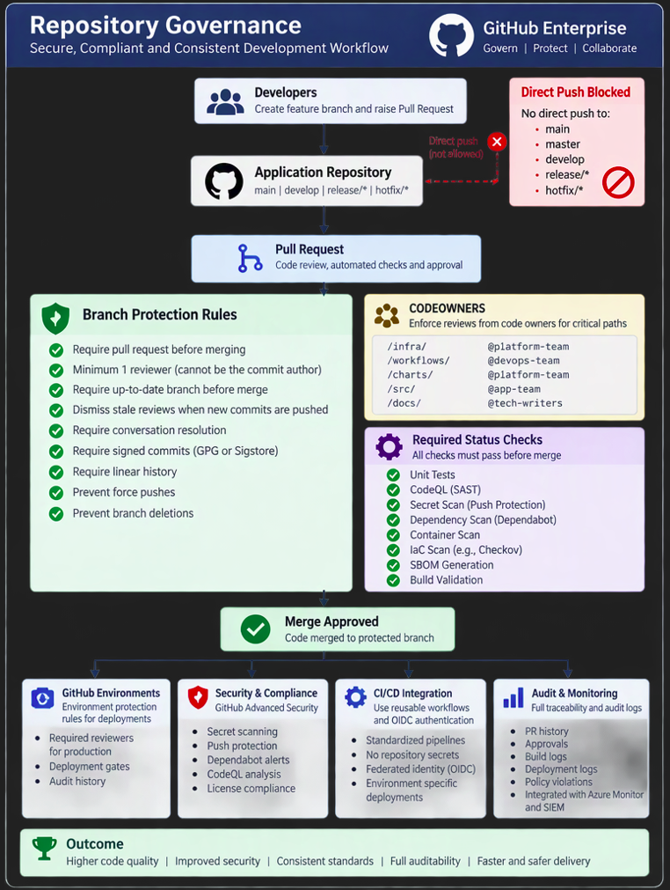
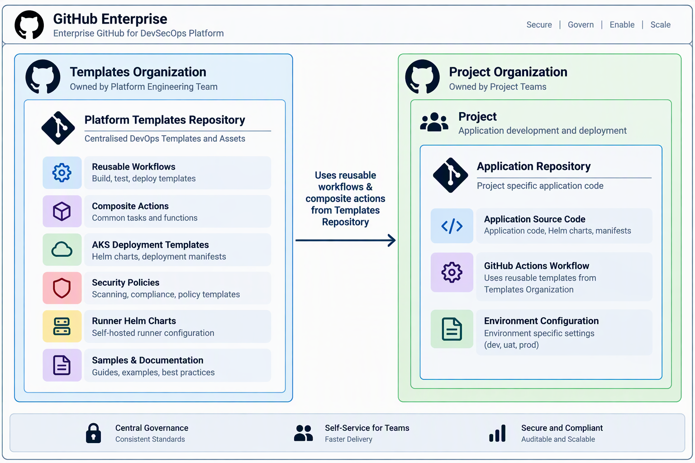
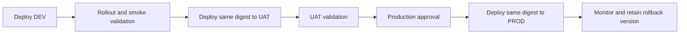
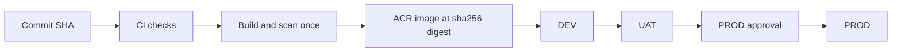
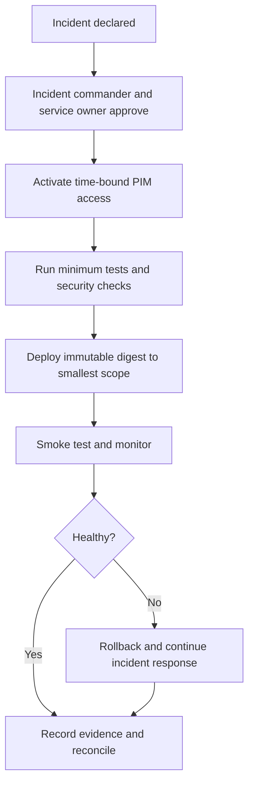

# Azure DevSecOps Platform Design Assessment

## Enterprise Paved-Road DevSecOps Platform

| Assessment detail | Value |
| --- | --- |
| **Selected cloud** | Microsoft Azure |
| **Candidate** | Nisharunnisa Shaik |
| **Role** | Senior DevOps Platform Engineer |
| **Version** | 1.0 |
| **Date** | November 2026 |

### Document control

| Platform area | Selection |
| --- | --- |
| Source control | GitHub Enterprise |
| CI/CD | GitHub Actions |
| Container platform | Azure Kubernetes Service (AKS) |
| Artifact repository | Azure Container Registry (ACR) |
| Secrets management | Azure Key Vault |
| Identity provider | Microsoft Entra ID |
| Self-hosted runners | GitHub Actions Runner Controller (ARC) on AKS |

> **Assessment status:** This document describes the proposed target platform. The repository currently contains a CI/CD scaffold; controls marked as proposed require implementation and GitHub/Azure configuration.

## Contents

1. [Executive summary](#1-executive-summary)
2. [Assumptions and exclusions](#2-assumptions-and-exclusions)
3. [Current-state challenges](#3-current-state-challenges)
4. [Platform architecture](#4-platform-architecture)
5. [Platform design](#5-platform-design)
6. [Controls as code](#6-controls-as-code)
7. [Artifact promotion strategy](#7-artifact-promotion-strategy)
8. [Progressive delivery runbook](#8-progressive-delivery-runbook)
9. [Emergency change workflow](#9-emergency-change-workflow)
10. [Metrics and reporting](#10-metrics-and-reporting)
11. [Migration and adoption plan](#11-migration-and-adoption-plan)
12. [Validation approach](#12-validation-approach)
13. [Risks and mitigations](#13-risks-and-mitigations)
14. [Known limitations](#14-known-limitations)
15. [Conclusion](#15-conclusion)
16. [References and AI disclosure](#16-references-and-ai-disclosure)

---

## 1. Executive summary

Forty engineering teams currently use inconsistent CI/CD implementations across multiple workloads. This creates fragmented audit evidence, broad production permissions, varying security standards, and inconsistent release and rollback practices.

The proposed Azure-based paved road provides:

- Centrally maintained reusable GitHub Actions workflows and composite actions.
- Ephemeral GitHub ARC runners for trusted build and deployment jobs.
- Federated workload identity instead of long-lived cloud credentials.
- Automated testing, security checks, artifact generation, and evidence capture.
- Build-once, promote-by-digest releases through development, UAT, and production.
- Progressive delivery, health-based promotion, and rollback.
- Central governance with documented extension points for application teams.

The platform standardizes mandatory controls while leaving application code, service-specific tests, and approved rollout thresholds with the owning teams.

## 2. Assumptions and exclusions

| Assumptions | Exclusions |
| --- | --- |
| GitHub Enterprise is the source control platform. | Azure landing-zone implementation. |
| AKS hosts containerized workloads. | Application-level architecture design. |
| ACR stores trusted container artifacts. | Enterprise network architecture. |
| GitHub Advanced Security is available. | Disaster recovery beyond deployment rollback. |
| Azure Key Vault is the secrets platform. | Application-specific business logic and SLOs. |

## 3. Current-state challenges

| Area | Challenge | Platform response |
| --- | --- | --- |
| Delivery | Inconsistent pipelines | Reusable workflows and standard release contracts |
| Security | Broad production permissions | Federated identities and scoped Azure RBAC |
| Compliance | Fragmented evidence | Central checks and traceable release records |
| Operations | Different deployment standards | Shared deployment templates and environment gates |
| Governance | Teams can bypass controls | Protected branches, code owners, and required checks |
| Reliability | Limited rollback capability | Progressive delivery with health-based rollback |

## 4. Platform architecture

### 4.1 Repository governance

The repository governance model combines branch protection, code-owner review, required security checks, environment protection, and auditable deployment history.

**Figure 1. Repository governance and security controls**

### 4.2 Platform and project organizations

Platform Engineering owns reusable workflows, composite actions, deployment templates, runner configuration, and security policies. Project teams own application repositories, service configuration, and release schedules.

**Figure 2. Templates and project organization model**

### 4.3 Ephemeral runner architecture

GitHub ARC provisions short-lived runner pods in AKS. Runners are created for trusted jobs and removed when those jobs complete, reducing the exposure of persistent runner credentials and workspaces.

**Figure 3. GitHub ARC self-hosted runner architecture**

### 4.4 End-to-end delivery architecture

The platform connects source control, reusable GitHub Actions workflows, ACR, and AKS deployments. Environment configuration changes between stages; the application image digest does not.

**Figure 4. End-to-end Azure DevSecOps platform architecture**

## 5. Platform design

### 5.1 Repository ownership model

| Repository location | Owner | Contents |
| --- | --- | --- |
| Platform/templates organization | Platform Engineering | Reusable workflows, composite actions, security policies, runner templates, samples, and documentation |
| Project organization | Application teams | Application source, Kustomize/Helm configuration, service tests, and environment-specific values |

### 5.2 Standard CI pipeline

Required checks fail closed: an image is not promoted if a mandatory test, policy, or security gate fails. Approved exceptions must have an owner, justification, compensating control, and expiry.

### 5.3 Standard CD pipeline

### 5.4 Reusable workflow contract

- Accept documented configuration through typed `workflow_call` inputs.
- Return stable outputs such as the immutable ACR image reference and deployment result.
- Keep mandatory security gates in the centrally maintained workflow.
- Pin reusable workflow and third-party action references to reviewed immutable revisions.
- Allow application teams to extend tests and configuration without disabling required controls.
- Deprecate breaking inputs through a published migration window.

## 6. Controls as code

Controls should run as pull-request and deployment gates. Repository settings, such as branch rulesets and Actions policies, should also be managed as code where practical and protected separately from the repository they govern.

For detailed repository implementation guidance, see [Repository Controls as Code](./REPOSITORY_CONTROLS_AS_CODE.md).

### 6.1 Repository controls

| Control | Enforcement | Evidence |
| --- | --- | --- |
| Protected branches | Require pull requests, code-owner approval, required checks, resolved conversations, and no force-push/deletion | Ruleset configuration and pull-request history |
| Workflow ownership | CODEOWNERS review for workflow, action, and policy changes | Code-owner review event |
| Least-privilege Actions token | Read-only `GITHUB_TOKEN` baseline; grant permissions only to the job that needs them | Workflow YAML and run permissions |
| Reusable workflow governance | Pin to reviewed revisions; use explicit inputs/secrets; prevent mandatory checks from being skipped | Workflow reference and run evidence |
| Environment protection | Require production approvers and scope deployment variables/secrets by environment | Deployment history and approval records |
| Security checks | Require tests, code scanning, dependency review, secret scanning, container/IaC checks | Required status checks and scan reports |

Branch patterns should be agreed with teams; a baseline is `main`, `develop`, `release/*`, and `hotfix/*`. Only make checks mandatory after confirming they run reliably for all relevant pull requests.

### 6.2 Security controls

| Control | Example implementation |
| --- | --- |
| SAST | GitHub CodeQL |
| Dependency scanning | Dependabot alerts/updates and dependency review |
| Secret detection | GitHub secret scanning and push protection |
| Container scanning | Trivy and/or Microsoft Defender for Cloud |
| Infrastructure scanning | Checkov or an equivalent policy scanner |
| SBOM generation | Syft; produce SPDX or CycloneDX for each image digest |
| Image signing | Cosign; verify the signature before promotion |

### 6.3 Identity and access

- Use GitHub OIDC federation with Microsoft Entra ID; avoid long-lived Azure credentials in repository secrets.
- Scope federated credentials to the expected repository and branch or GitHub Environment.
- Use separate identities for image publishing, non-production deployment, and production deployment.
- Grant Azure roles at the narrowest applicable scope. The build identity should push only to the required ACR; a deployment identity should access only its target AKS resources and namespace.
- Keep ACR pull permissions on the AKS kubelet identity separate from deployment permissions.
- Store application secrets in Key Vault and retrieve only what a job needs.
- Use time-bound privileged access through Microsoft Entra PIM for approved emergency work.

No long-lived cloud credentials should be committed to repositories or printed in workflow logs.

## 7. Artifact promotion strategy

Build an image once from the approved commit, record its digest, then deploy that exact digest in each environment. Do not rebuild or retag different image bytes for UAT or production. If separate ACRs are required, replicate the artifact and verify the digest remains unchanged.

Capture the commit SHA, image digest, SBOM/signature references, workflow run, approvals, and deployment outcome for every promotion.

## 8. Progressive delivery runbook

### 8.1 AKS canary strategy

Deploy the candidate alongside the stable workload. Route a small percentage of traffic to the candidate, pause at each stage, evaluate service and infrastructure signals, and advance only when gates pass.

| Stage | Candidate traffic | Minimum observation |
| --- | ---: | --- |
| Initial | 10% | 10 minutes |
| Expand | 25% | 10 minutes |
| Expand | 50% | 10 minutes |
| Complete | 100% | Continue monitoring for 30 minutes |

Use Azure Monitor, Application Insights, and Container Insights for request, application, and cluster signals. Define an ingress, service-mesh, or gateway traffic-shifting mechanism before enabling the canary.

### 8.2 Promotion and rollback gates

| Signal | Example threshold |
| --- | --- |
| Error rate | Roll back above 2% |
| Availability | Roll back below 99.5% |
| Response time | Investigate/rollback above 500 ms or the service SLO |
| Failed health checks | Roll back after more than 5 consecutive failures |

Stop promotion and restore the stable version when a hard threshold is breached. Preserve logs, events, metric snapshots, and the candidate digest for diagnosis. Tune thresholds per service SLO and traffic volume before production use.

### 8.3 Database changes

Use expand/contract changes:

1. Add backward-compatible schema, such as nullable fields or additive tables.
2. Deploy code that works with both old and new schema.
3. Backfill data through observable, restartable jobs.
4. Remove obsolete schema only in a later release after all consumers have migrated.

Take and verify backups before destructive changes. Application rollback must not depend on reversing an irreversible database migration.

## 9. Emergency change workflow

Emergency changes are for active incidents or material security risks, not schedule pressure.

### Required controls

- Record the incident/change ID, severity, service, impact, incident commander, and approvers.
- Activate least-privilege Microsoft Entra PIM access with MFA and justification; maximum activation duration is **4 hours**.
- Retain minimum gates: build/focused tests, secret scan, dependency check, image scan/signature verification, and smoke test.
- Deploy one immutable digest to the smallest affected scope; monitor health and retain a rollback option.
- Capture commit, digest, approvals, PIM activation, pipeline run, test/scan results, and before/after monitoring signals.
- Complete a post-incident review within **48 hours**. Back-merge the change, remove temporary access, close exceptions, and assign corrective actions.

## 10. Metrics and reporting

Join GitHub deployment records with Azure Monitor and incident data using service, environment, commit SHA, and image digest.

### DORA metrics

| Metric | Definition | Primary source |
| --- | --- | --- |
| Deployment frequency | Successful production deployments per service per week | GitHub deployment history |
| Lead time for changes | Median and 75th percentile from merge to production | Git and deployment timestamps |
| Change failure rate | Production deployments followed within 7 days by rollback, hotfix, or attributable incident, divided by production deployments | Deployment and incident records |
| Mean time to recovery | Median time from incident start to verified recovery | Incident timestamps and Azure Monitor |

### Platform and control metrics

| Metric | Target |
| --- | ---: |
| Template adoption | >90% |
| Security scan coverage | 100% |
| OIDC adoption | 100% |
| Deployment success rate | >95% |
| Rollback success rate | >99% |

Publish formulas and time windows. Count emergency and failed releases consistently; pair delivery speed with reliability and security outcomes. Use metrics for platform improvement, not individual ranking or quotas.

## 11. Migration and adoption plan

| Phase | Activities | Exit criteria |
| --- | --- | --- |
| **1. Discovery** | Inventory repositories, pipelines, owners, environments, credentials, IaC, and baseline metrics | Each production service has an owner and migration priority |
| **2. Platform readiness** | Publish reusable workflows, runner platform, onboarding guide, and security controls | Templates and security checks pass representative validation |
| **3. Pilot adoption** | Onboard five representative applications; validate build, deployment, security checks, and rollback | Pilot release and rollback complete with evidence |
| **4. Migration waves** | Wave 1: 10 low-complexity apps; Wave 2: 15 medium-complexity apps; Wave 3: 15 critical production apps | Each wave meets agreed service-level onboarding criteria |
| **5. Continuous improvement** | Review DORA/control metrics, resolve exceptions, and improve templates | No unowned exceptions; adoption and platform SLO targets are met |

Project teams receive an onboarding guide, deployment runbook, troubleshooting guide, and office-hours support. Keep legacy pipelines available during the transition; onboard one service at a time rather than requiring a big-bang rewrite.

## 12. Validation approach

| Validation area | Checks |
| --- | --- |
| Functional | Build, tests, deployment, artifact digest consistency, and environment promotion |
| Security | Secret scanning, dependency review, code scanning, container/IaC scans, signature verification |
| Operational | Canary progression, rollback, monitoring alerts, and evidence retention |
| Governance | Pull-request approval, CODEOWNERS enforcement, required checks, environment approvals, and bypass audit |

Test policy changes in a representative repository before broad enforcement. Validate both the normal path and failure paths, including a failed check, rejected production approval, unhealthy rollout, and emergency rollback.

## 13. Risks and mitigations

| Risk | Mitigation |
| --- | --- |
| Legacy pipeline incompatibility | Provide documented extension points and migration adapters |
| Project resistance | Pilot with teams, publish evidence of reduced toil, and provide office hours |
| Security exceptions become permanent | Require named owners, compensating controls, and expiry dates |
| Deployment failure | Use progressive delivery, health gates, and tested rollback |
| Skills gap | Provide training, runbooks, and platform support |
| Central workflow outage or breaking change | Version releases, test compatibility, maintain rollback to prior workflow versions |

## 14. Known limitations

- Legacy applications may require custom build or deployment steps.
- Some workloads may need approved, time-limited exceptions.
- Progressive delivery depends on sufficient traffic and observability.
- GitHub branch rulesets, environment approvals, and organization-wide required workflows depend on repository ownership and GitHub plan capabilities.
- This assessment describes a target design; workflow gates and Azure permissions must be implemented and verified before production adoption.

## 15. Conclusion

The proposed platform gives forty engineering teams a secure, scalable delivery path while preserving application-team ownership. Central reusable workflows, ephemeral runners, federated identity, immutable artifact promotion, progressive delivery, and auditable repository controls establish consistent standards without requiring a big-bang pipeline rewrite.

## 16. References and AI disclosure

### References

- [GitHub Enterprise](https://github.com/enterprise)
- [GitHub Actions](https://docs.github.com/en/actions)
- [GitHub Advanced Security](https://docs.github.com/en/get-started/learning-about-github/about-github-advanced-security)
- [GitHub Actions Runner Controller](https://docs.github.com/en/actions/hosting-your-own-runners/managing-self-hosted-runners-with-actions-runner-controller)
- [Azure Kubernetes Service](https://learn.microsoft.com/en-us/azure/aks/)
- [Azure Container Registry](https://learn.microsoft.com/en-us/azure/container-registry/)
- [Azure Key Vault](https://learn.microsoft.com/en-us/azure/key-vault/)
- [Azure Monitor](https://learn.microsoft.com/en-us/azure/azure-monitor/)
- [Microsoft Well-Architected Framework](https://learn.microsoft.com/en-us/azure/well-architected/)

### AI assistance disclosure

Generative AI assisted with document structure, wording, and diagram drafting. The platform design, assumptions, thresholds, implementation status, and references should be reviewed by the responsible engineering and security owners.
