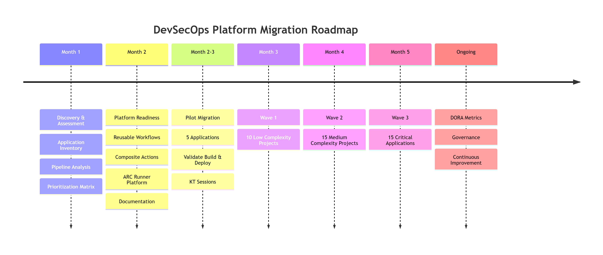

# DevSecOps Platform Migration and Adoption Plan

This plan describes how to move application teams onto the Azure DevSecOps paved road in controlled, measurable waves. It supplements the [Azure DevSecOps Platform Assessment](./Azure_DevSecOps_Platform_Assessment.md) with execution steps, ownership, readiness gates, and evidence requirements.

## 1. Objectives and scope

The migration will:

- Move application repositories to centrally maintained, versioned GitHub Actions workflows.
- Standardize build, test, security scanning, artifact promotion, and deployment controls.
- Use environment-specific Azure managed identities and least-privilege access.
- Preserve application-team ownership of source code, service tests, deployment configuration, and release decisions.
- Establish repeatable production approval, monitoring, and rollback evidence.

The initial planning assumption is a cohort of 40 applications across 40 engineering teams. Discovery must confirm the actual application-to-team mapping, ownership, and migration count before dates or capacity are committed. AKS is the primary target; Azure App Service workloads require a separately validated deployment path because its reusable deployment template is not yet implemented.

## 2. Migration principles

1. **Migrate incrementally.** Keep the existing pipeline available while each service proves the new path; do not use a big-bang cutover.
2. **Build once, promote by digest.** Do not rebuild an artifact for UAT or production.
3. **Keep production protected.** Preserve required checks, environment approvals, separation of duties, and the approved production branch/ref policy.
4. **Fail closed on mandatory gates.** Missing test, scan, approval, or health evidence is not a pass.
5. **Make exceptions temporary and accountable.** Every exception needs an owner, rationale, compensating control, approver, and expiry.
6. **Separate implemented controls from planned controls.** Prisma image scanning is implemented in the current workflow; SBOM generation, image signing, IaC scanning, and App Service deployment automation remain gaps until implemented and evidenced.
7. **Measure outcomes, not individual performance.** Use service-level onboarding and reliability metrics to improve the platform.

## 3. Rollout structure

The rollout is gate-based rather than tied to unvalidated calendar dates. The five pilot applications are included in Wave 1; the wave totals below describe a single 40-application planning cohort, not 45 applications.

| Phase | Cohort / focus | Main activities | Exit gate |
| --- | --- | --- | --- |
| 1. Discovery | All candidate applications | Inventory owners, repositories, current workflows, languages, tests, environments, deployment targets, identities, secrets, dependencies, criticality, release frequency, and rollback approach. Record current delivery and control baselines. | Every in-scope application has a named owner, inventory record, migration priority, target path, and known exceptions. |
| 2. Platform readiness | Shared platform | Publish reusable workflows and versioning policy; validate runner capacity and network access; configure Azure identities and ACR permissions; document onboarding and support; verify required repository and Environment protections. | Representative CI and non-production CD runs pass; required controls and evidence are reviewable; rollback is tested. |
| 3. Pilot | Five representative applications, selected from Wave 1 | Include different build/deployment complexity where possible. Migrate one service at a time; exercise pull-request checks, Dev deployment, UAT promotion, production approval, monitoring, and rollback. Capture team feedback and update templates/docs. | Each pilot completes a production-like release and a successful rollback or documented rollback exercise; no unresolved critical control gaps remain. |
| 4. Wave 1 | Ten low-complexity applications, including the five pilots | Reuse the pilot playbook; onboard the remaining low-complexity services; resolve repeatable configuration issues centrally rather than adding one-off forks. | All ten services meet the standard onboarding acceptance checklist, or have approved, time-limited exceptions. |
| 5. Wave 2 | Fifteen medium-complexity applications | Migrate services with additional integrations, deployment configuration, or test needs. Validate extension points without weakening centrally required controls. | Each service passes its agreed test, security, deployment, approval, and recovery checks; exceptions have owners and expiry dates. |
| 6. Wave 3 | Fifteen critical production applications | Migrate high-criticality services with service owners, platform support, incident contacts, and an agreed change window. Rehearse rollback and confirm production approval coverage. | Production owner accepts the operational runbook and evidence; release and recovery checks pass before legacy retirement. |
| 7. Continuous improvement | All onboarded services | Review adoption, DORA, security, reliability, and exception metrics. Improve workflow versions and onboarding guidance through tested, backward-compatible changes. | No unowned exceptions; platform targets are reviewed regularly; corrective actions have owners and due dates. |

**Figure 1. DevSecOps platform migration and adoption roadmap**

## 4. Application onboarding procedure

For each application, the application owner and platform team complete these steps:

1. **Confirm ownership and service profile.** Record the service owner, technical contacts, criticality, runtime, repository, support/on-call route, release constraints, and dependencies.
2. **Assess compatibility.** Confirm the supported build path, required tests, deployment target, Kustomize/Helm or other configuration, health checks, and any custom build or release needs.
3. **Agree the migration change.** Select the workflow version, migration window, cutover approach, rollback method, and any temporary exceptions. Keep the existing pipeline available until the new path is accepted.
4. **Configure repository governance.** Establish protected branches, required pull-request reviews and checks, `CODEOWNERS` where appropriate, and repository security settings. Developers must not bypass protected-branch controls.
5. **Configure environments and Azure access.** Set up Dev, UAT, and Prod GitHub Environments; configure required reviewers and prevent self-review; disable administrator bypass where the policy requires no bypass. Assign each environment's MSI only the Azure permissions it needs. Keep secrets in Key Vault.
6. **Run non-production validation.** Verify CI tests and quality checks, Prisma image scanning, Dev deployment, smoke test, digest-based UAT import, and UAT validation. Confirm the exact image digest remains unchanged across promotions.
7. **Run production readiness review.** Confirm production approval separation, monitoring and alert ownership, deployment window, rollback digest, incident contacts, and evidence retention. Production approval must not be used to bypass required checks.
8. **Cut over and observe.** Use the protected production workflow, monitor the service against its agreed health signals, and retain the prior pipeline during the agreed stabilization period.
9. **Close migration.** Obtain service-owner acceptance, record the workflow version and evidence links, document remaining exceptions, and retire the legacy pipeline only after the exit criteria are met.

## 5. Onboarding acceptance checklist

An application is considered migrated only when applicable items are verified and recorded:

- [ ] Named service owner, support contacts, and repository ownership are documented.
- [ ] Pull requests require the agreed reviews and checks; direct protected-branch updates are restricted.
- [ ] Required repository security settings and dependency checks are enabled or tracked as explicit exceptions.
- [ ] CI tests and quality gates run and block release on failure.
- [ ] Container scanning runs against the built image; the result is retained with the run and image digest.
- [ ] The image is built once and promoted between registries by immutable digest.
- [ ] GitHub Environments use the intended deployment refs, environment reviewers, and self-review protection.
- [ ] Azure access uses the approved MSI and least-privilege role assignments; no long-lived credential is embedded in workflow files.
- [ ] Dev and UAT deployment, health checks, and failure handling have been exercised.
- [ ] Production approval and monitoring responsibilities are clear, and rollback uses a known-good digest.
- [ ] Run links, commit, image digest, approvals, scan/test results, and rollout/rollback outcomes are retained as evidence.
- [ ] Known gaps and exceptions have named owners, compensating controls, and expiry dates.

SBOM generation, image signing, IaC scanning, and automated progressive delivery must not be marked complete solely because they appear in the target design. Record them as open controls until implementation and verification evidence are available.

## 6. Roles and decision ownership

| Role | Migration responsibilities |
| --- | --- |
| Platform/DevOps team | Own reusable workflows, runner platform, Azure integration patterns, onboarding materials, platform support, and central defect fixes. Review platform changes and publish compatible workflow versions. |
| Application/service owner | Own service inventory, migration priority, compatibility decisions, service tests, health signals, operational runbook, and acceptance of the migrated release path. |
| Developer | Update the application repository and deployment configuration through pull requests; resolve workflow and test failures. |
| Lead developer / code owner | Review application changes, confirm service-specific test and configuration quality, and approve pull requests within the protected-branch policy. |
| Production approver | Review the production deployment context and approve or reject it through the protected GitHub Environment. Approval does not grant code-write or administrator access. |
| Repository administrator | Configure access, rulesets, Actions policy, and Environment protection; keep administrative access limited and auditable. |
| Security / risk owner | Define mandatory control requirements, review exceptions, and verify remediation and exception expiry. |

## 7. Migration failure and rollback

If a migration or release fails:

1. Stop promotion and preserve the failed run, commit, image digest, scan/test results, and relevant Azure Monitor signals.
2. Restore service using the established legacy path or the known-good deployment digest, whichever is approved and proven for that service.
3. Do not remove production approval or required checks to force the migration through.
4. Record the impact, recovery action, root cause, and owner for corrective work.
5. Resume the migration only after the failed gate is understood, remediation is reviewed, and the affected exit criteria pass again.

The legacy pipeline is a temporary continuity option during migration, not an indefinite parallel production path. Define its retirement condition and owner in each service's migration record.

## 8. Evidence and reporting

Maintain a migration record per application with:

- Service owner, repository, cohort/wave, target workflow version, and migration status.
- Baseline and post-migration delivery/control measures, with definitions and time windows.
- Pull-request checks, workflow run links, test and scan artifacts, commit SHA, and image digest.
- Environment protection and approval evidence, Azure identity/role assignments, and deployment outcome.
- Monitoring/health evidence, rollback test or recovery record, and service-owner acceptance.
- Open risks, exceptions, compensating controls, approvers, and expiry dates.

Track rollout progress with these measures:

| Measure | Target / interpretation |
| --- | --- |
| Applications with named owners and migration priority | 100% before migration waves are scheduled |
| Applications using approved workflows | More than 90% after planned adoption; report denominator and exclusions |
| Security scan coverage | 100% of in-scope image builds; open gaps are visible and owned |
| Azure jobs using approved MSI access | 100% of in-scope Azure jobs |
| Deployment success rate | Greater than 95%, measured consistently across environments |
| Rollback success rate | Greater than 99%, based on exercised and production recovery records |
| Exceptions without owner or expiry | 0 |

Report DORA metrics alongside security and reliability outcomes. Use the same service identifiers, commit SHAs, image digests, and time windows when joining GitHub deployment records, Azure Monitor data, and incident records. Do not use team-level adoption metrics to rank individuals.

## 9. Risks and mitigations

| Risk | Mitigation |
| --- | --- |
| Application inventory or ownership is incomplete | Make named ownership and service inventory a discovery exit gate; do not schedule an unowned service. |
| Legacy applications do not fit the standard workflow | Use documented extension points and versioned migration adapters; keep mandatory controls centrally enforced. |
| Platform changes break application callers | Version reusable workflows, test representative callers, publish deprecation windows, and maintain a rollback path to the prior version. |
| Teams retain long-lived exceptions | Require a named approver, compensating control, expiry, and recurring review for each exception. |
| Runner or network capacity blocks onboarding | Validate capacity and required Azure/registry/Key Vault connectivity before the pilot and monitor queue and failure rates by wave. |
| Production cutover causes service impact | Use a service-owner-approved window, health gates, known-good digest, and tested recovery procedure. |
| Target controls are assumed to be implemented | Maintain an evidence-based control status; distinguish current workflow capabilities from proposed platform features. |
| App Service workloads are treated as AKS-ready | Validate and implement an App Service-specific deployment path before onboarding those services. |

## 10. Related documents

- [Azure DevSecOps Platform Assessment](./Azure_DevSecOps_Platform_Assessment.md)
- [Repository Controls as Code](./REPOSITORY_CONTROLS_AS_CODE.md)
- [Repository README](./README.md)
