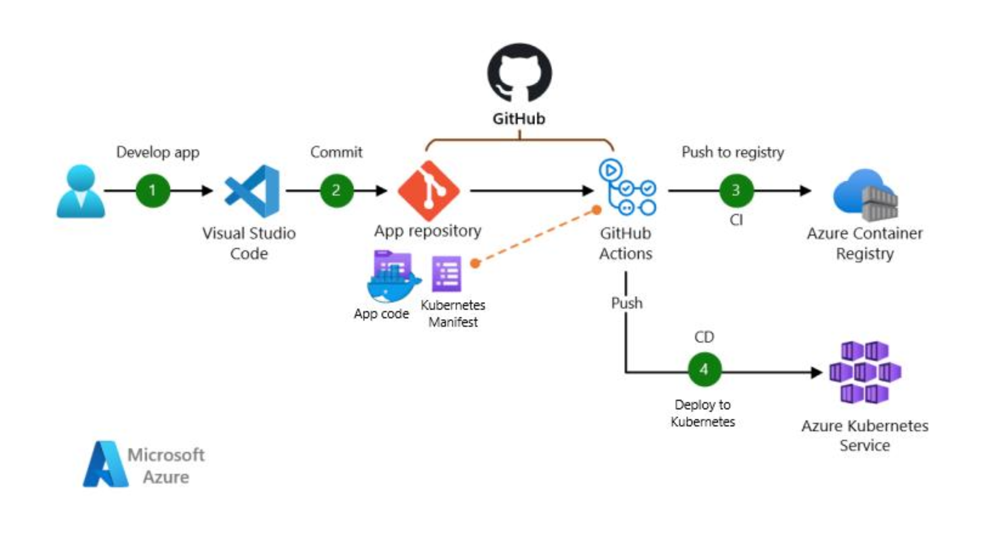
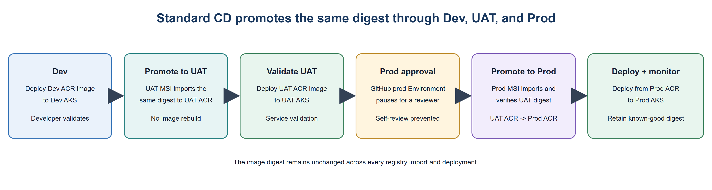

# Azure Enterprise DevOps Platform

## 1. Executive summary

This submission proposes an Azure-based delivery platform using GitHub Actions, Azure Container Registry (ACR), Azure Kubernetes Service (AKS), and managed identities. The repository contains reusable CI/CD workflows and supporting actions. It is a scaffold, not a production-validated platform: environment configuration and Azure permissions still need to be completed and tested.

## 2. Architecture

The design and component descriptions are in [Section 4 of the assessment](Azure_DevSecOps_Platform_Assessment.md#4-platform-architecture).

## 3. Assessment report

- [Assessment PDF](Azure_DevSecOps_Platform_Assessment.pdf)
- [Assessment source (Markdown)](Azure_DevSecOps_Platform_Assessment.md)

## 4. CI/CD implementation

The application workflows call reusable templates in this repository:

| Workflow | Purpose |
| --- | --- |
| [Maven CI template](.github/workflows/maven-ci.yml) | Maven tests, SonarQube, ACR image build, and Prisma scan |
| [AKS deployment template](.github/workflows/aks-deploy.yml) | Load environment config, promote an image by digest, deploy with Kustomize, and optionally smoke-test |
| [Standard application workflow](../maven-application/.github/workflows/ci-cd.yml) | Run CI, then promote through Dev, UAT, and Prod |
| [Emergency workflow](../maven-application/.github/workflows/emergency-deploy.yml) | Roll back to an existing image or build, scan, and deploy a fix |

Composite action details are under [`.github/actions`](.github/actions). Application settings are in the sibling [`maven-application`](../maven-application/) repository.

## 5. Artifact promotion

CI builds and scans one image. The release flow promotes its digest from Dev to UAT and then to Prod; it does not rebuild the image between environments. See [Section 7 of the assessment](Azure_DevSecOps_Platform_Assessment.md#7-artifact-promotion-strategy).

## 6. Governance and security

- [Repository controls guide](REPOSITORY_CONTROLS_AS_CODE.md)
- [Roles, controls, and Environment design](Azure_DevSecOps_Platform_Assessment.md#5-platform-design)
- [Production Environment evidence and status](Azure_DevSecOps_Platform_Assessment.md#45-production-environment-evidence)

The design calls for protected branches, code-owner reviews, least-privilege managed identities, and production approval. Confirm the settings in the application repository before relying on them.

## 7. Migration and adoption

See the [Migration and Adoption Plan](MIGRATION_AND_ADOPTION_PLAN.md) for the discovery steps, five-application pilot, phased waves, acceptance checklist, and evidence to retain. The proposed rollout has not yet been carried out.

## 8. Evidence

### Available

- [Environment deployment branch/tag rules screenshot](docs/evidence/prod-deployment-branches.png) — evidence for the `Prod Approval` Environment; this is not a repository branch-ruleset screenshot.
- [Environment approval settings screenshot](docs/evidence/prod-approval-settings.png) — shows reviewers and prevent-self-review for `Prod Approval`; administrator bypass is enabled in the capture.
- [Simulation workflow run](https://github.com/Nisharunnisa-Shaik/azure-enterprise-maven-application/actions/runs/45573909623) — demonstrates workflow orchestration only. It did not build an image or contact Azure.

**Production approval configuration needs correction:** the deployment workflow targets an Environment named `prod`, while the reviewer configuration is on `Prod Approval`. At the time of this review, `prod` had no protection rules. Configure and verify reviewers on the exact `prod` Environment before treating approval as an active control.

### Not yet available

- A successful real CI/CD or emergency deployment run with test, scan, digest, approval, and deployment evidence.
- Repository branch-ruleset screenshots and verified Azure role assignments.
- Azure Monitor or Application Insights rollout and rollback evidence.

## 9. Known limitations

- Application configuration and Maven, Dockerfile, and Kustomize scaffold files still need completion before a real run.
- Prisma image scanning is in the workflow; IaC scanning, SBOM generation, and image signing are not implemented.
- AKS weighted-canary and App Service slot deployment automation are not implemented.
- The emergency workflow documents PIM use, but does not activate or enforce time-limited PIM access.
- Simulation mode echoes workflow stages and uses synthetic `.invalid` image references. It is not deployment or security-control evidence.
- Reusable workflows and actions currently use mutable `@main` references; pin reviewed revisions before production use.

For setup variables, runner prerequisites, and workflow inputs, see the [assessment](Azure_DevSecOps_Platform_Assessment.md) and [repository controls guide](REPOSITORY_CONTROLS_AS_CODE.md).
